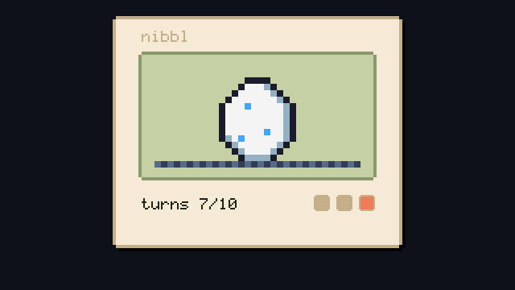
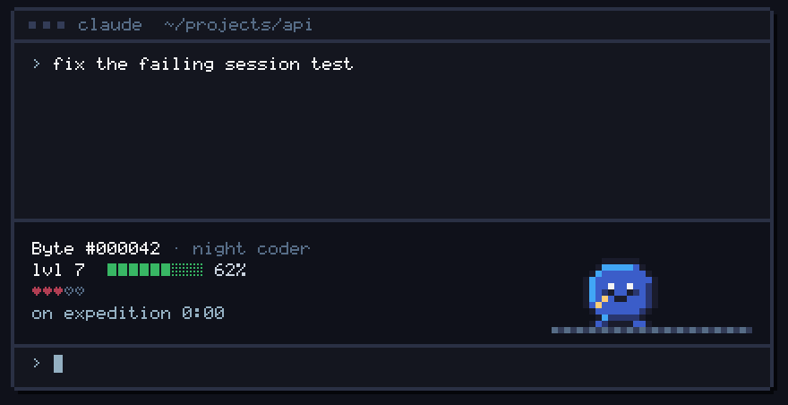
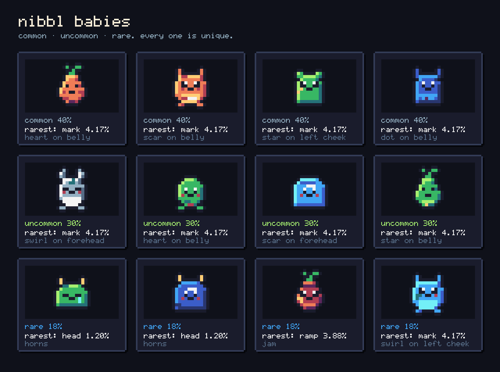

<p align="center">
  
</p>

<h1 align="center">nibbl</h1>

<p align="center"><b>A tiny pixel pet that nibbles your bugs.</b><br>It lives above your Claude Code prompt, reacts to your real work and grows with you for months.</p>

<p align="center">
  <a href="https://github.com/nuromirzak/nibbl/stargazers"></a>
  <a href="https://github.com/nuromirzak/nibbl/releases"></a>
  <a href="LICENSE"></a>
  <a href="https://code.claude.com/docs"></a>
  
</p>

## Install

In Claude Code:

```
/plugin marketplace add https://getnibbl.pages.dev/marketplace.json
/plugin install nibbl@nibbl
```

No account, no login, no API key. An egg appears above your prompt. Keep working and it hatches.

To get new versions automatically: `/plugin`, then **Marketplaces**, select **nibbl**, **Enable auto-update**. Claude Code leaves it off for community marketplaces.

<p align="center">
  
</p>

## Why you will like it

- **It is yours.** Every nibbl is one of a kind, with its own genome and a serial number. Nobody else will ever have the same one.
- **It notices your work.** A failing tool drops a bug into its tiny world. Green tests? It eats the bug. The rest you will discover yourself.
- **It grows with you.** From egg to baby to forms you only see by getting there. How you work decides what it becomes.
- **It never gets in the way.** It never blocks Claude, never nags and never dies. Leave for a month and it is still there, asleep.
- **It costs nothing.** Zero model tokens, nothing to buy, nothing to farm.

## Lucky?

| Common | Uncommon | Rare | Epic | Legendary | Shiny |
|:---:|:---:|:---:|:---:|:---:|:---:|
| 40% | 30% | 18% | 9% | 3% | 4% |

One roll per machine, forever. Every nibbl also gets at least one trait rarer than 5%, so even a common one has something special.

<p align="center">
  
</p>

## Show it off

Every nibbl gets its own card page and a rank on the [leaderboard](https://getnibbl.pages.dev/leaderboard/). This is Byte, live:

<p>
  <a href="https://getnibbl.pages.dev/p/000013"></a>
</p>

<details>
<summary>Put yours on your GitHub profile</summary>

Run `/nibbl badge`. It prints the markdown below with your own serial, ready to paste into your profile README (`github.com/<you>/<you>`):

```markdown
[](https://getnibbl.pages.dev/p/000013)
```

</details>

## What's new in 0.4

- **Visits.** When a friend waves at you, their nibbl walks into your scene for about 90 seconds. No toast, no text.
- **Coding today.** `/nibbl`, the band and the site show how many nibbls synced in the last 24 hours. Only the count, never who.
- **`/nibbl badge`.** Prints the markdown for your live badge, for your GitHub profile.
- **Gift eggs.** At level 10 and level 25 your nibbl lays an egg for a friend. `/nibbl egg` shows the code; the friend runs `/nibbl egg <code>` before hatching and their nibbl is your child and inherits your mark when possible. No XP, no better odds.

## What's new in 0.3

- **A daily greeting.** Your nibbl says hello on the first turn of each day, and its mood follows the time of day.
- **Evolution and `/nibbl share`.** When it grows into a new stage you get a ready post text and the link to its card.
- **Achievements.** 15 of them, awarded by the server from real work and shown on the card. `/nibbl achievements` lists yours.
- **`/nibbl invite`.** Bring a friend by serial (now an alias of `/nibbl egg`). No XP, no better odds.
- **Nibbl of the week.** The pet that gained the most XP Monday to Sunday (UTC) gets the crown: [getnibbl.pages.dev/week](https://getnibbl.pages.dev/week/).

## FAQ

**Does it slow Claude down or cost tokens?** No. It is drawn by plain code and never calls the model.

**What does it send?** Only that something happened (a turn, a passing check, a commit) and when. Never your code, prompts, files or commands. Details in [how it works](docs/how-it-works.md) and the [privacy policy](https://getnibbl.pages.dev/privacy/).

**Can it die?** Never.

**Can I reroll?** No. That is what makes it yours.

**Is it open source?** Yes, MIT. See [how it works](docs/how-it-works.md) if you want to look inside or help.

---

<p align="center">
  If nibbl made you smile, a star helps other Claude Code users find it.<br><br>
  <a href="https://getnibbl.pages.dev">getnibbl.pages.dev</a> · <a href="https://getnibbl.pages.dev/llms.txt">llms.txt</a> · made for <a href="https://code.claude.com/docs">Claude Code</a> · not affiliated with Anthropic
</p>
